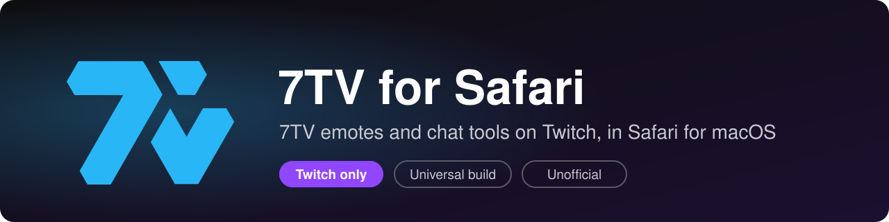
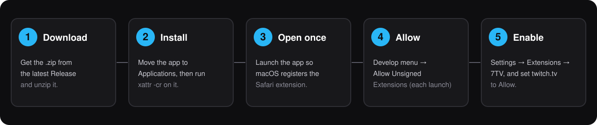
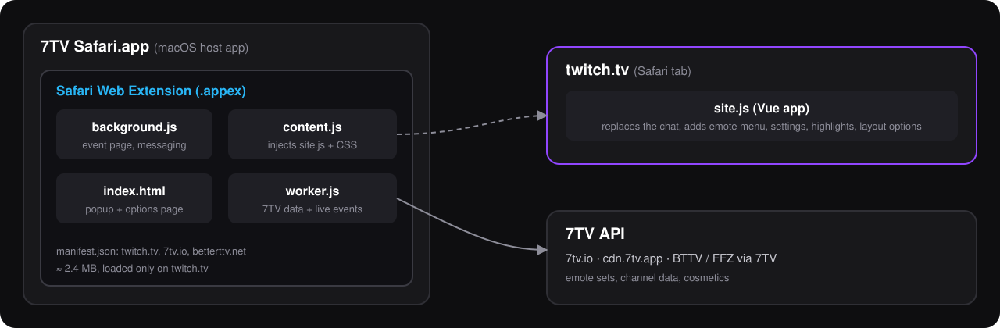

<p align="center">
  
</p>

<p align="center">
  <a href="https://github.com/romanovak/7tv-for-safari/releases/latest"></a>
  
  
  
  
</p>

<p align="center"><b>English</b> · <a href="README.es.md">Español</a></p>

**7TV for Safari** packages the open-source [7TV browser extension](https://github.com/SevenTV/Extension) for **Safari on macOS**, restricted to **twitch.tv** and slimmed down from 14 MB to about 2.4 MB. You get 7TV emotes in chat, the emote menu, chat and layout settings, highlights and more, without the extra weight of other sites.

> **Unofficial.** This project is not affiliated with or endorsed by 7TV or Twitch. The 7TV name and logo belong to their owners.
>
> **Status: experimental.** Built and tested on a single Mac. Parts of the extension depend on Twitch's page structure and may break when Twitch changes it.

## Contents

- [Features](#features)
- [Install the prebuilt app](#install-the-prebuilt-app)
- [Build from source](#build-from-source)
- [How it works](#how-it-works)
- [Repository layout](#repository-layout)
- [Troubleshooting](#troubleshooting)
- [Why isn't it on the App Store?](#why-isnt-it-on-the-app-store)
- [License](#license)

## Features

- 7TV emotes in Twitch chat, with the in-chat emote menu and `:emote` autocomplete.
- About 100 official settings: chat appearance, highlights, timestamps, moderation helpers, player and layout tweaks.
- **Twitch only.** No YouTube or Kick permissions are requested.
- **Lightweight.** The ~8 MB of emoji sprite sheets that the stock build injects into every page were removed; native Apple emoji are used instead. Onboarding images and source maps are also dropped.
- **Universal binary** (Apple Silicon and Intel).

## Install the prebuilt app

<p align="center">
  
</p>

Requires **macOS 13 or later** with Safari.

1. **Download** `7TV-for-Safari-<version>-macOS.zip` from the [latest release](https://github.com/romanovak/7tv-for-safari/releases/latest) and unzip it.
2. **Move** `7TV Safari.app` to your `Applications` folder, then remove the download quarantine flag:
   ```bash
   xattr -cr "/Applications/7TV Safari.app"
   ```
   (Alternatively, right-click the app and choose **Open**.)
3. **Open the app once** so macOS registers the Safari extension, then quit it.
4. In Safari, enable the Develop menu: **Settings → Advanced → Show features for web developers**.
5. Choose **Develop → Allow Unsigned Extensions** and enter your password. *Safari forgets this setting every time it quits, so repeat it after each restart.*
6. Go to **Safari → Settings → Extensions**, tick **7TV**, then click **Edit Websites…** and set `twitch.tv` to **Allow** (allow `7tv.io` too if prompted).
7. Open a channel on [twitch.tv](https://www.twitch.tv) and reload the page.

**Verify the download** (optional): `shasum -a 256 7TV-for-Safari-<version>-macOS.zip` must match the `SHA256.txt` published with the release.

> The app is **ad-hoc signed, not notarized**, because distributing a persistent Safari extension requires a paid Apple Developer account. That is why steps 2 and 5 are needed. See [Why isn't it on the App Store?](#why-isnt-it-on-the-app-store).

## Build from source

Requires full **Xcode** (not only the Command Line Tools).

```bash
git clone https://github.com/romanovak/7tv-for-safari.git
cd 7tv-for-safari
open "official-project/7TV Safari/7TV Safari.xcodeproj"
```

1. In Xcode, select the project, then for **both** targets (*7TV Safari* and *7TV Safari Extension*) open **Signing & Capabilities**:
   - choose your **Team** (a free Apple ID works);
   - change the **Bundle Identifier** from `com.example.sevntv` to your own, e.g. `com.yourname.sevntv`. The extension's identifier must be the app's identifier plus `.Extension`.
2. Update `extensionBundleIdentifier` in `7TV Safari/ViewController.swift` to match.
3. Press **⌘R**, then follow steps 4–7 of the install guide above.

### Scripts

| Script | What it does |
|---|---|
| `scripts/build-release.sh [version]` | Builds the universal, ad-hoc signed app from a neutral path, scans for leaked local paths and writes `dist/…zip` + `SHA256.txt`. Needs Xcode. |
| `scripts/build-extension.sh` | Rebuilds `extension-official/` from upstream commit `69eaa09` (v3.1.26): clones, applies `patches/`, builds, then runs `scripts/safari-manifest.py`. Needs node ≥ 18, yarn 1.x, git, python3. |

The bundled `extension-official/` is exactly what `build-extension.sh` produces.

## How it works

<p align="center">
  
</p>

Safari only loads web extensions that ship inside a macOS app. `official-project/` is that wrapper (generated with `safari-web-extension-converter`). The extension is the upstream build: a tiny content script injects `site.js`, a Vue app that hooks into Twitch's chat, and a worker talks to the 7TV API. A structural analysis of upstream (in Spanish) is in [`docs/ANALYSIS.es.md`](docs/ANALYSIS.es.md).

### Changes from upstream

- Manifest adapted for Safari: `background.scripts` instead of a service worker, no `default_area`, no source maps.
- Host permissions limited to `twitch.tv`, `7tv.io`, `cdn.7tv.app` and the BTTV endpoints; YouTube and Kick removed.
- Emoji sprite injection removed ([`patches/0001-drop-emoji-sprite-injection.patch`](patches/0001-drop-emoji-sprite-injection.patch)).
- Onboarding images, nightly icons and source maps removed.

## Repository layout

| Path | Description |
|---|---|
| `extension-official/` | Safari-ready build of the official 7TV extension (v3.1.26). **This is the one to use.** |
| `official-project/` | Xcode project that wraps it as a Safari app extension. |
| `extension-lite/` | Minimal from-scratch alternative (about 6 KB of code): 7TV + BTTV + FFZ emotes only, no settings. See its [README](extension-lite/README.md). |
| `patches/` | Source patches applied on top of upstream. |
| `scripts/` | Reproducible build scripts. |
| `docs/` | Images and notes. |

## Troubleshooting

| Problem | Fix |
|---|---|
| The extension doesn't show up in Safari | Quit Safari (⌘Q), reopen it, and make sure the app was opened once. Repeat **Allow Unsigned Extensions**. |
| It appears twice | Another copy of the app is registered (e.g. in Xcode's `DerivedData`). Delete stale copies and restart Safari. |
| No emotes on Twitch | Check that `twitch.tv` is set to **Allow**, reload, then open **Develop → Show Web Inspector** and look for errors. |
| macOS says the app is damaged or from an unidentified developer | Run the `xattr -cr` command from step 2, or right-click → **Open**. |
| Xcode: *Embedded binary's bundle identifier is not prefixed…* | The extension ID must be `<app-id>.Extension`. |
| Everything turned off after restarting Safari | Expected with unsigned extensions: repeat **Develop → Allow Unsigned Extensions**. |

## Why isn't it on the App Store?

Distributing a Safari extension without the "unsigned" workaround requires an Apple Developer Program membership (paid) for signing and notarization, plus App Review for the App Store. If this project gets a signed build, it will be announced in the releases.

## License

- 7TV's code and assets (`extension-official/`, upstream logos) are distributed under the **Commons Clause** license, see [`LICENSE-7TV.md`](LICENSE-7TV.md). **This repository must not be sold.**
- Everything written for this port (`extension-lite/`, `scripts/`, `patches/` as modifications, the Xcode wrapper and documentation) is released under the [MIT License](LICENSE).
